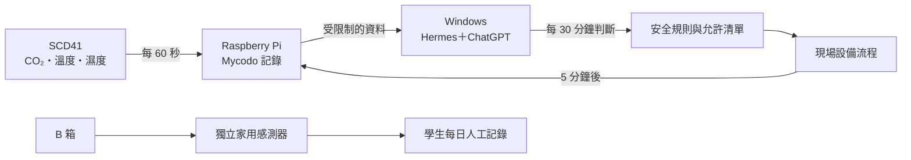

# AI 全集中・菇之呼吸

## AI 智慧生長箱 × 秀珍菇科學展覽

這是一個國小科展研究專案。我們想回答的問題是：

> **讓 AI 持續閱讀生長箱的環境數據並協助判斷，秀珍菇的生長情形會和一般人工觀察有什麼不同？**

研究以兩個生長箱進行比較：

- **A 箱（AI 實驗組）**：使用 SCD41 感測器、Raspberry Pi、Mycodo，以及 Windows 電腦上的 Hermes＋ChatGPT，記錄並分析環境變化。
- **B 箱（人工對照組）**：不連接 AI，沒有加濕器與風扇；學生每天使用獨立家用感測器，人工記錄 CO₂、溫度與濕度。

本儲存庫保存研究中使用的 **Mycodo／SCD41 資料讀取、離線重播、AI 決策前檢查與安全限制程式**，也讓評審及對 AI、物聯網或智慧農業有興趣的人，可以了解我們如何把「AI 種菇」拆解成可觀察、可驗證的科學問題。

> [!IMPORTANT]
> **本儲存庫目前公開的是安全的唯讀／dry-run 版本，不是可直接控制硬體的完整部署程式。**<br>
> 程式不會開啟風扇或霧化器；`executed_commands` 永遠為空，`--execute` 一律拒絕。公開程式碼不等於研究現場的硬體已被遠端啟用。

---

## 一、研究動機

秀珍菇的生長會受到溫度、濕度、CO₂ 與通風影響。一般種植需要靠人觀察，但人不可能 24 小時站在生長箱旁。

因此，我們想嘗試：

1. 用感測器定期收集環境資料。
2. 用 Mycodo 保存資料並管理現場設備。
3. 讓 Hermes＋ChatGPT 依照受限制的資料與規則協助判斷。
4. 把 AI 箱和人工觀察箱的生長紀錄放在一起比較。
5. 同時思考：**AI 可以協助到什麼程度？哪些安全決定仍然必須由人負責？**

這個研究的重點不只是「把機器做出來」，而是觀察資料、比較結果、記錄失敗，並誠實說明研究限制。

---

## 二、研究問題與比較方式

### 研究問題

AI 輔助監測的 A 箱，和人工觀察的 B 箱，在以下項目是否出現差異？

- 首次出菇時間
- 每日外觀與生長變化
- 採收重量
- 最大菇傘直徑
- CO₂、溫度與濕度的變化
- 設備動作前後的環境反應

### A／B 箱設計

| 項目 | A 箱：AI 實驗組 | B 箱：人工對照組 |
|---|---|---|
| 菇種 | 秀珍菇 | 秀珍菇 |
| AI 連線 | 有 | 無 |
| 固定感測器 | SCD41 | 無固定串聯感測器 |
| 環境讀值 | 每 60 秒記錄 | 每日觀察時人工讀取 |
| AI 判斷 | 每 30 分鐘 | 無 |
| 動作後檢查 | 5 分鐘後重新檢查 | 不適用 |
| 加濕器／風扇 | A 箱系統設備 | 無 |
| 生長照片 | 學生每天固定角度拍攝 | 學生每天固定角度拍攝 |

> [!NOTE]
> A、B 箱使用不同廠牌的感測器，精度與反應速度可能不同，因此必須列為研究限制，不能把所有差異都直接歸因於 AI。

---

## 三、系統如何運作



### 分工原則

- **SCD41**：量測 A 箱的 CO₂、溫度與濕度。
- **Raspberry Pi／Mycodo**：負責感測、保存紀錄與現場系統管理。
- **Hermes＋ChatGPT**：讀取允許的資料、整理狀態並提出受限制的判斷。
- **學生**：每日觀察、固定角度拍照、記錄 B 箱數據與整理實驗結果。
- **成人指導者**：處理電源、設備安全、權限與敏感資料。

如果 Windows、網路或 Hermes 停止，Mycodo 仍可繼續保存感測紀錄；但此時不能說 AI 仍在持續判斷。

---

## 四、這個 GitHub 儲存庫展示什麼

本儲存庫不是為了展示一個可以隨意遠端開關設備的程式，而是展示我們如何設計一個**先驗證、再判斷、預設拒絕危險操作**的資料流程。

### 可以做的事

- 重播已保存的 Mycodo GET API 報告。
- 使用明確標示的離線測試資料，檢查決策邏輯。
- 檢查資料時間是否過期、在未來或格式不正確。
- 驗證 SCD41 量測頻道與允許的設備識別。
- 在另行取得操作者同意後，透過 HTTPS 進行固定路徑的唯讀 GET。
- 產生 JSON、去除敏感內容的 audit 紀錄與跳脫處理後的 HTML 報告。

### 刻意不能做的事

- 不能執行 `--execute`。
- 不能送出 POST 或任意硬體控制命令。
- 不能使用任意 Shell、SSH、`pinctrl` 或臨時 `curl` 繞過限制。
- 不能自行填入未核准的溫度、濕度、CO₂ 或設備運轉門檻。
- 不能把離線測試數值當成真正的秀珍菇實驗結果。
- 不能把 B 箱接入 AI 或遠端控制。

---

## 五、安全設計

我們採用「**不確定就停止**」的原則：

1. **預設不核准**：門檻、資料來源或限制沒有完整確認時，不產生計畫。
2. **資料必須新鮮**：過期、未來、缺少或非有限數值都會被阻擋。
3. **計畫與執行分開**：`planned_commands` 只是離線建議；`executed_commands` 永遠為空。
4. **唯讀路徑白名單**：只能讀取預先允許的 Mycodo GET 路徑。
5. **TLS 驗證**：沒有跳過憑證驗證的選項，也拒絕重新導向。
6. **憑證不進命令列**：API key 只能用遮罩輸入或環境變數提供。
7. **輸出識別不可猜測**：缺少可靠對應時，設備狀態維持 `unknown`。
8. **兒童不接觸市電**：110V／220V、市電接線與設備安全由成人處理。

這些限制不代表完整的實體控制安全已獲證明；它們代表目前公開版本的能力邊界被刻意縮小。

---

## 六、評審可以從哪些檔案開始閱讀

| 檔案／資料夾 | 用途 |
|---|---|
| `README.md` | 科展問題、A／B 箱設計與系統總覽 |
| `SKILL.md` | Hermes 讀取與解讀資料時必須遵守的規則 |
| `mycodo_scd41/core.py` | 資料驗證、離線判斷、唯讀 API 與安全限制 |
| `tests/` | 24 項安全與防禦性測試 |
| `fixtures/` | 已保存報告與明確標示的離線測試資料 |
| `docs/TDD-record.md` | 先寫失敗測試、再完成程式的 TDD 紀錄 |
| `docs/future-control-checklist.md` | 未來若研究實體控制，必須先完成的安全清單 |
| `THIRD_PARTY/` | 上游專案來源與 MIT 授權說明 |

---

## 七、如何在不連接硬體的情況下重現

### 執行環境

- Python 3.10 以上
- 只使用 Python 標準函式庫
- 不需要安裝額外套件
- 從專案根目錄執行

### 1. 執行全部測試

```console
python -m unittest discover -s tests -v
```

目前驗證結果：

```text
Ran 24 tests
OK
```

### 2. 重播保存的報告

```console
python -m mycodo_scd41 replay \
  --report fixtures/recorded-report.json \
  --config config.example.json
```

預期重點：

- 來源標示為保存報告，不是假裝成現在的 Pi 資料。
- 原始量測時間不會被改寫。
- 未核准的門檻與過期資料會阻擋計畫。
- 執行指令數為 0。

### 3. 執行離線模擬

```console
python -m mycodo_scd41 simulate \
  --fixture fixtures/offline-test.json
```

離線 fixture 只用來測試判斷流程，所有數字都不是本次科展的正式結果。即使模擬產生 `planned_commands`，`executed_commands` 仍為空。

---

## 八、目前驗證狀態

| 項目 | 狀態 |
|---|---|
| 安全回歸測試 | 24／24 通過 |
| 保存資料離線重播 | 已驗證 |
| 離線模擬 | 已驗證 |
| 實際硬體控制 | 此公開版本未提供 |
| 現場 TLS／API 整合 | 尚未在本儲存庫完成驗證 |
| 正式實驗結果 | 整理中，完成後更新 |
| 結案網站 | 建置中，後續放在 `/docs` |

---

## 九、研究限制

- A、B 箱的感測器廠牌不同。
- B 箱為每日人工讀值，不是和 A 箱相同頻率的連續資料。
- 系統沒有自動相機；所有生長照片由學生每天固定角度拍攝。
- 單次科展的箱體、菇包與環境數量有限，不能直接推論到所有種植情境。
- 感測器資料、AI 建議與秀珍菇實際生長之間，需要透過紀錄與結果分析才能建立關係。
- 程式測試通過，只代表測試涵蓋的邏輯符合預期，不代表完整實體系統已經沒有風險。

---

## 十、專案目前階段

本專案採分階段整理：

1. **系統與安全程式**：本儲存庫目前內容。
2. **科展網站建置版**：整理研究故事、方法、照片位置與圖表版型。
3. **正式數據分析**：補入每日紀錄、採收資料與圖表。
4. **學生反思與結論**：依真正結果回答研究問題，不預先宣稱 A 箱較好。
5. **公開發布**：完成家長同意、照片去識別與敏感資料檢查後才公開。

---

## 授權與來源

本專案依據上游 Setasoma `mycodo-hermes-skill` 的架構重新整理，來源 commit 與 MIT 授權資訊請參閱：

- `THIRD_PARTY/NOTICE.md`
- `THIRD_PARTY/upstream-LICENSE`
- 本儲存庫的 `LICENSE`

## 主題聲明

本專案的招式名稱靈感來自《鬼滅之刃》，研究、程式與學生原創插圖均由本組自行完成；本專案與原作品及權利人無關。程式庫不收錄官方角色圖片、官方 Logo 或漫畫截圖。
